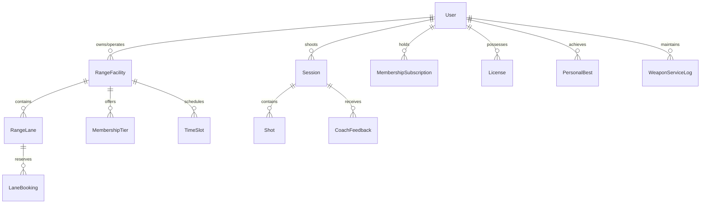

# Marksman Platform — Comprehensive Feature & Function Catalog

> **Document Version**: 2.4.0  
> **Classification**: Technical Specifications & Architectural Reference  
> **Last Updated**: October 12, 2026  
> **App Ecosystem**: Shooter App (`:3000`), Range Management (`:3002`), Target Camera (`:8081`), Vision Engine (`:8000`), Version 2 Range Ops  

---

## 📑 Table of Contents
1. [Ecosystem Overview & Topology](#1-ecosystem-overview--topology)
2. [Application 1: Shooter App (Athlete & Coaching Portal)](#2-application-1-shooter-app-athlete--coaching-portal)
3. [Application 2: Range Management App (Operator & RSO Command)](#3-application-2-range-management-app-operator--rso-command)
4. [Application 3: Target Camera App (Downrange Hardware Interface)](#4-application-3-target-camera-app-downrange-hardware-interface)
5. [Application 4: Version 2 Range Ops (Next-Gen Infrastructure)](#5-application-4-version-2-range-ops-next-gen-infrastructure)
6. [Microservice: Computer Vision & Shot Detection Engine](#6-microservice-computer-vision--shot-detection-engine)
7. [High-Performance Wireless Streaming & ABR Engine](#7-high-performance-wireless-streaming--abr-engine)
8. [Downrange Optical Impact Verification & Snapshot Protocol](#8-downrange-optical-impact-verification--snapshot-protocol)
9. [Database Schema & Data Models](#9-database-schema--data-models)
10. [Safety, Regulatory Compliance & Legal Architecture](#10-safety-regulatory-compliance--legal-architecture)
11. [Acoustic-Optical Sensor Fusion (Smart Phone Mic Trigger & Chronograph)](#11-acoustic-optical-sensor-fusion-smart-phone-mic-trigger--chronograph)
12. [10m Olympic Airgun Target Hardware Box Specifications](#12-10m-olympic-airgun-target-hardware-box-specifications)
13. [Commercial Pricing & Academy ROI Model (INR ₹)](#13-commercial-pricing--academy-roi-model-inr-)
14. [Local Development, Orchestration & Credentials](#14-local-development-orchestration--credentials)
15. [Product Development Roadmap & Academy Pilot Program](#15-product-development-roadmap--academy-pilot-program)

---

## 1. Ecosystem Overview & Topology

The **Marksman Platform** modernizes kinetic shooting ranges by coupling physical range hardware with cloud microservices, downrange high-speed camera sensors, automated computer vision scoring, and athlete analytics.

```
                           ┌─────────────────────────┐
                           │   Range Management Web  │
                           │   (Next.js 15 - :3002)  │
                           └────────────┬────────────┘
                                        │ (HTTP / WSS)
                                        ▼
┌──────────────────────────┐   ┌─────────────────────────┐   ┌──────────────────────────┐
│       Shooter Web        │◄──┤   Range Management API  ├──►│   Target Camera Edge     │
│   (Next.js 15 - :3000)   │   │     (NestJS - :3003)    │   │  (React Native - :8081)  │
└────────────┬─────────────┘   └────────────┬────────────┘   └─────────────┬────────────┘
             │ (HTTP / WSS)                 │                              │
             ▼                              ▼                              │
┌──────────────────────────┐   ┌─────────────────────────┐                 │
│       Shooter API        │   │    PostgreSQL Database  │                 │
│     (NestJS - :3001)     │   │      (Docker - :5433)   │                 │
└────────────┬─────────────┘   └─────────────────────────┘                 │
             │                              ▲                              │
             │ (HTTP REST)                  │ (State Sync)                 │
             ▼                              │                              │
┌──────────────────────────┐   ┌────────────┴────────────┐                 │
│      Vision Engine       │◄──┤   Version 2 Range Ops   │◄────────────────┘
│   (FastAPI/CV - :8000)   │   │    (NestJS / Next.js)   │  (Raw MJPEG / WSS binary)
└──────────────────────────┘   └─────────────────────────┘
```

---

## 2. Application 1: Shooter App (Athlete & Coaching Portal)

### 2.1 Overview & Architecture
* **Frontend**: Next.js 15 (App Router), React 19, Tailwind CSS, Lucide Icons, Canvas 2D / WebGL rendering.
* **Backend**: NestJS (Modular Architecture), Prisma ORM, Socket.IO Gateway.
* **Primary Roles**: `SHOOTER`, `COACH`, `SOLDIER`.
* **Port**: Web: `http://localhost:3000` | API: `http://localhost:3001`.

### 2.2 Key User Interface Routes
| Route | Access Role | Description & Functionality |
| :--- | :--- | :--- |
| `/` | Public | Marketing landing page, platform overview, system status indicator. |
| `/auth/login` | Public | Credentials authentication, Google OAuth SSO, demo account quick-login toasts. |
| `/dashboard` | Shooter | Athlete home base: recent session stats, quick training launch, profile completeness badge. |
| `/sessions` | Shooter | Historical shooting logbook with filtering by discipline, weapon caliber, and date range. |
| `/sessions/new` | Shooter | Active session wizard: target standard selection (ISSF 10m/25m/50m, NRA B-8, IPSC), weapon pairing. |
| `/sessions/[id]` | Shooter / Coach | Detailed session review: shot group dispersion, Mean Point of Impact (MPI), score breakdown. |
| `/live-analysis` | Shooter | Real-time downrange camera stream, multi-angle view (Target, Stance, Bay), live shot plotting. |
| `/shooter/membership` | Shooter | Digital Membership Card: glassmorphism card, turnstile dynamic QR code, gate access validator. |
| `/shooter/leaderboard` | All | Real-time ELO rating leaderboard, division ranking, tier badges (Master, Diamond, Platinum). |
| `/coach/athletes` | Coach | Coach roster: view assigned shooters, review historical diagnostics, send training plans. |
| `/coach/feedback` | Coach | Interactive feedback interface for leaving timestamped audio/text notes on shooter sessions. |
| `/docs` | All | In-app shooter & athlete training manual, safety guidelines, and calibration tutorials. |

### 2.3 Detailed Features & Mathematical Working

#### A. Mean Point of Impact (MPI) & Dispersion Analytics
* **Mathematical Calculation**:
  $$\text{MPI}_x = \frac{1}{N} \sum_{i=1}^N x_i, \quad \text{MPI}_y = \frac{1}{N} \sum_{i=1}^N y_i$$
  $$\text{Group Radius (Mean Radius)} = \frac{1}{N} \sum_{i=1}^N \sqrt{(x_i - \text{MPI}_x)^2 + (y_i - \text{MPI}_y)^2}$$
  $$\text{Extreme Spread (ES)} = \max_{j, k} \sqrt{(x_j - x_k)^2 + (y_j - y_k)^2}$$
* **Visualization**: Interactive HTML5 Canvas rendering of the official target rings with sub-millimeter bullet impacts plotted with color-coded series progression.

#### B. Algorithmic ELO Rating System
* **Rating Formula**:
  $$\text{Discipline ELO} = 1400 + \Delta_{\text{consistency}} + \Delta_{\text{accuracy}} + \Delta_{\text{pressure}}$$
  Where base skill starts at 1400, scaled dynamically by tournament finishes, average ring score relative to target discipline standard, and inner-ten (X-ring) hit density.

#### C. AI Coach Intelligence (Groq & Google GenAI Integration)
* **Working**: Analyzes shot temporal cadence (split times between shots), heart rate telemetry, and spatial drift from center.
* **Prompt Engineering Pipeline**: Translates raw JSON shot matrices into structured ISSF coaching advice (e.g., identifying trigger freeze, anticipating recoil, or canting the rifle barrel).

#### D. Turnstile Gate Digital Access Card
* **Security**: Time-rotating HMAC SHA-256 token embedded in a 2D QR matrix.
* **Working**: When presented at the range entrance turnstile, decrypts the member's tier, expiry date, and lane reservation permissions in under 120 ms.

---

## 3. Application 2: Range Management App (Operator & RSO Command)

### 3.1 Overview & Architecture
* **Frontend**: Next.js 15, Tailwind CSS, Recharts, WebSocket clients.
* **Backend**: NestJS, Prisma ORM, Socket.IO Gateway.
* **Primary Roles**: `RANGE_OPERATOR`, `RSO` (Range Safety Officer), `ADMIN`.
* **Port**: Web: `http://localhost:3002` | API: `http://localhost:3003`.

### 3.2 Key User Interface Routes
| Route | Access Role | Description & Functionality |
| :--- | :--- | :--- |
| `/range-operator/dashboard` | Operator / RSO | Central command dashboard: real-time lane status matrix, occupancy KPIs, revenue widgets. |
| `/range-operator/bookings` | Operator | Live 1-hour availability matrix (9 AM – 6 PM), walk-in reservation modal, booking cancellation. |
| `/range-operator/setup` | Operator | Multi-step range verification wizard: upload facility permits, physical address validation. |
| `/live-analysis` | Operator / RSO | Full-range video wall: simultaneous multi-lane target camera feeds with health telemetry. |
| `/turnstile-scanner` | RSO / Staff | Gate check-in tool: scans shooter digital passes, validates active reservations, unlocks turnstile. |
| `/environmental` | Operator / RSO | OpenMeteo live weather data: temperature, humidity, crosswind velocity, wind-score impact analytics. |
| `/docs` | Operator / RSO | Operational manuals: OSHA lead air protocols, acoustic standards, emergency cease-fire SOPs. |

### 3.3 Detailed Features & Operational Working

#### A. Multi-Facility Management Architecture
* **Multi-Range Roster**: Range operators can register and operate unlimited physical range branches under a single user account.
* **Header Facility Switcher**: Real-time dropdown that swaps active range context across all state hooks and API queries without re-authenticating.
* **Auto-Initialization**: Registering a secondary facility automatically provisions 4 standard 10m airgun lanes in the database with default operating hours.

#### B. 1-Hour Time Slot Booking Matrix
* **Working**: Generates 9 daily 60-minute time slots (09:00 to 18:00).
* **Collision Detection**: Real-time concurrency checks prevent overbooking lane capacity.
* **Walk-In Check-In**: Range Safety Officers can assign walk-in shooters directly to empty lanes, producing an on-the-spot physical slip or digital receipt.

#### C. Cross-Application Emergency Ceasefire System
* **WebSocket Channel**: `range_ceasefire` broadcast over Socket.IO.
* **Fail-Safe Mechanism**: When an RSO presses **"EMERGENCY CEASE FIRE"**:
  1. An audible klaxon audio tone is triggered.
  2. Every connected screen (Shooter App, Range Kiosk, Mobile APK) is overlaid with a high-contrast flashing red lockout banner: `🛑 CEASE FIRE ORDERED - UNLOAD AND SHOW CLEAR`.
  3. Shot recording is instantly suspended at the API level until the RSO clears the range.

#### D. Environmental Telemetry & Crosswind Analysis
* **Weather Ingestion**: Queries OpenMeteo API for real-time wind speed ($m/s$), gust velocity, wind direction ($0^\circ - 360^\circ$), barometric pressure ($hPa$), and relative humidity.
* **Ballistic Deflection Correlation**: Correlates recorded shot drift with crosswind vectors to help shooters calculate precise MOA / MIL optic turret corrections.

---

## 4. Application 3: Target Camera App (Downrange Hardware Interface)

### 4.1 Overview & Architecture
* **Framework**: React Native with Expo SDK.
* **Deployment**: Standalone Release Android APK (`target-camera-release.apk`) running on ruggedized Android hardware or tablets.
* **Downrange Mounting**: Deployed at the target line inside an AR500 steel deflector enclosure.
* **Port / Dev Server**: `http://localhost:8081`.

### 4.2 Hardware & Optical Specifications
```
      Bullet Trajectory ───────► [Target Paper / Steel]
                                         │
                                         ▼ (45° Deflection Angle)
     ┌─────────────────────────────────────────────────────────┐
     │ 3/8" AR500 Armor Plate (Rated for .308 Win / 7.62 NATO) │
     └─────────────────────────────────────────────────────────┘
                                   │
                                   ▼
    ┌───────────────────────────────────────────────────────────┐
    │  Dual Camera Rig: 120 FPS High-Speed Optical Sensor       │
    │  Sacrificial Polycarbonate Lens Shield                    │
    │  1000 - 1500 Lux DC Constant-Voltage LED Array            │
    │  Wi-Fi 6 (5GHz) / 2.4GHz Edge Fallback Wireless Antenna   │
    └───────────────────────────────────────────────────────────┘
```

### 4.3 Operational Working
1. **Homography Matrix Calibration**: On initialization, the app performs a 4-point perspective warp against target registration marks, normalizing camera angle skew into a square coordinate frame.
2. **Frame Capture & Compression**: Captures frames at up to 60 FPS in 1080p, compressing them via WebGL2 / Hardware NVENC into optimized binary blobs.
3. **Dual Stream Mode**:
   * Mode A: Continuous low-latency video stream over WebSockets (`/shots/live-frame`).
   * Mode B: Triggered **Shot Impact Snapshot** transmission upon downrange optical disturbance detection.

---

## 5. Application 4: Version 2 Range Ops (Next-Gen Infrastructure)

### 5.1 Overview & Scope
`Version_2_Range_Ops` is the advanced evolution of the operations module, introducing deep hardware sensor scripts, team squad management, armory logistics, and TV Kiosk Mode.

### 5.2 Key Modules & Capabilities

#### A. Full-Screen TV Kiosk Mode (`/competitions/[id]/kiosk`)
* Designed for large 4K displays mounted in range clubhouses or spectator stands.
* Real-time leaderboard table displaying shooter seed numbers, nation/club flags, shot-by-shot ring scores, and total ISSF decimal scores.
* Animated elimination highlights: Automatically highlights the bottom-ranked shooter during ISSF Finals single-elimination shoot-offs.

#### B. Squad & Team Training Management
* Coaches can create multi-athlete `Squad` rosters (e.g., "National Junior Rifle Squad", "Police Tactical Unit Alpha").
* Bulk assign training drills from the centralized `Drill` catalog (e.g., "10-Shot Hold Stability", "Rapid Fire 4-Second String").

#### C. Armory Registry & Handloading Tracker
* **Weapon Service Logs**: Tracks round counts fired through each barrel, recording cleaning intervals, bore scoping, and headspace inspections.
* **Ammunition Lot Tracker (`AmmoLot`)**: Logs powder charge weights, bullet grain, manufacturer lot numbers, and muzzle velocities to diagnose ammunition variance vs. shooter error.

#### D. Immutable Security Audit Trail (`AuditLog`)
* Logs all sensitive administrative actions (emergency overrides, score adjustments, manual gate unlocks) with user ID, IP address, and timestamp.

---

## 6. Microservice: Computer Vision & Shot Detection Engine

### 6.1 Architecture
* **Stack**: Python 3.11, FastAPI, OpenCV 4.x, NumPy, Uvicorn.
* **Port**: `http://localhost:8000`.

### 6.2 Computer Vision Pipeline
```
Raw Frame ──► Grayscale ──► Gaussian Blur (5x5) ──► Frame Differencing (Background Subtraction)
                                                             │
                                                             ▼
Coordinate Translation ◄── Sub-Pixel Centroid ◄── Contour & Ellipse Fit ◄── Adaptive Thresholding
(Normalized mm)            (Hough Circles)
```

1. **Background Subtraction**: Compares the current frame with a baseline target reference image captured before the shot.
2. **Hole Detection**: Identifies localized contrast anomalies corresponding to bullet perforations through paper or lead marks on electronic backplates.
3. **Contour Fitting**: Uses OpenCV `findContours()` followed by `fitEllipse()` to detect bullet entry hole geometry, calculating sub-pixel center $(x, y)$.
4. **Ring Scoring Algorithm**:
   $$r = \sqrt{x_{\text{mm}}^2 + y_{\text{mm}}^2}$$
   Translates radial distance $r$ into decimal score (e.g., $r \le 0.5\text{ mm} \implies 10.9$, $r \le 5.0\text{ mm} \implies 10.0$).
5. **JSON Telemetry Dispatch**: Emits payload to NestJS API containing score, coordinates in millimeters, radial dispersion, and confidence score.

---

## 7. High-Performance Wireless Streaming & ABR Engine

Implemented in [`apps/web/lib/stream-optimizer.ts`](file:///d:/App%20and%20Hardware%20Project/App/Marksman/Shooter_App/apps/web/lib/stream-optimizer.ts):

### 7.1 Five Standard Stream Profiles
| Profile Preset | Resolution | Target FPS | Bitrate Cap | Jitter Buffer | Network Target |
| :--- | :--- | :--- | :--- | :--- | :--- |
| **`LAN_ULTRA_LOW_LAT`** | 1080p | 60 FPS | 6,000 kbps | 0 ms | Gigabit Range LAN / Fiber (sub-12ms RTT) |
| **`BALANCED_WIRELESS`** | 720p | 30 FPS | 2,500 kbps | 50 ms | Standard 5GHz Wi-Fi / LTE |
| **`AUTO_ADAPTIVE`** | Dynamic | Dynamic | Dynamic | Dynamic | Automated real-time network adjustment |
| **`BANDWIDTH_SAVER`** | 480p | 15 FPS | 800 kbps | 100 ms | Weak wireless links (<6 Mbps upload) |
| **`ECO_BATTERY`** | 360p | 10 FPS | 400 kbps | 150 ms | Edge device battery preservation |

### 7.2 Real-Time Network Quality Metric Calculation
* **Round-Trip Time (RTT)**: Monitored via WebSocket ping-pong timestamps.
* **Drop Rate Calculation**:
  $$\text{Drop Rate \%} = \frac{\text{Dropped Frames}}{\text{Expected Frames}} \times 100$$
* **Quality Bands**:
  * **`EXCELLENT`**: RTT $< 45\text{ ms}$, Drop Rate $< 1\%$.
  * **`GOOD`**: RTT $45 - 90\text{ ms}$, Drop Rate $1 - 4\%$.
  * **`FAIR`**: RTT $90 - 180\text{ ms}$, Drop Rate $4 - 12\%$.
  * **`POOR`**: RTT $> 180\text{ ms}$ or Drop Rate $> 12\%$.

---

## 8. Downrange Optical Impact Verification & Snapshot Protocol

When downrange Wi-Fi suffers heavy interference (common at outdoor 300m–1000m ranges with metal baffles):

1. **Automatic Edge Failover**: If network quality enters `POOR` (drop rate $> 12\%$ or RTT $> 200\text{ ms}$), the system disengages continuous video streaming and switches to **On-Device Edge Calculation Mode** (`ON_DEVICE_EDGE`).
2. **Shot Impact Snapshot Generation**:
   * The downrange camera performs localized edge scoring.
   * Generates a compressed Base64 JPEG crop of the exact impact zone with timestamp, shot number, and coordinate overlay.
3. **Payload Broadcast**: Emits `shot_impact_snapshot` WebSocket event:
   ```json
   {
     "laneId": "lane-04",
     "shotNumber": 12,
     "score": 10.7,
     "xMm": 0.18,
     "yMm": -0.24,
     "image": "data:image/jpeg;base64,...",
     "timestamp": 1791744800000
   }
   ```
4. **Instant Verification Pop-Up**: RSO screens and shooter live target monitors pop up an instant verification zoom showing the physical bullet hole within 50 ms of impact.

---

## 9. Database Schema & Data Models

Managed via Prisma with PostgreSQL:



### Key Models & Attributes:
* **`User`**: `id`, `email`, `passwordHash`, `role` (`SHOOTER`, `COACH`, `RANGE_OPERATOR`, `SOLDIER`), `profileCompleteness`, `googleId`.
* **`RangeFacility`**: `id`, `name`, `address`, `totalLanes`, `isSetupComplete`, `ownerId`.
* **`RangeLane`**: `id`, `laneNumber`, `status` (`IDLE`, `OCCUPIED`, `OFFLINE`), `targetType`, `rangeId`.
* **`LaneBooking`**: `id`, `bookingReference`, `slotId`, `numberOfShooters`, `qrCodeUrl`, `checkInAt`, `status`.
* **`MembershipTier`**: `id`, `name` (Silver, Gold, Elite), `monthlyPrice`, `discountPercent`, `bookingLimitHours`.
* **`Session`**: `id`, `shooterId`, `discipline`, `weaponCaliber`, `totalScore`, `averageScore`, `deletedAt`, `sessionDate`.
* **`Shot`**: `id`, `sessionId`, `shotNumber`, `score`, `xMm`, `yMm`, `timestamp`, `splitTimeSec`.
* **`AuditLog`**: `id`, `actorId`, `action`, `resource`, `ipAddress`, `timestamp`.

---

## 10. Safety, Regulatory Compliance & Legal Architecture

Documented in [`docs/LEGAL_COMPLIANCE_AND_STANDARDS.md`](file:///d:/App%20and%20Hardware%20Project/App/Marksman/docs/LEGAL_COMPLIANCE_AND_STANDARDS.md):

* **OSHA 29 CFR 1910.1025 (Lead Airborne Exposure)**:
  * Specifies minimum 50–75 fpm laminar airflow past the shooter stall downrange toward the bullet trap.
  * Negative air pressure maintenance and HEPA air filter replacement tracking in the Range Ops dashboard.
* **OSHA 1910.95 (Occupational Acoustic Protection)**:
  * Strict adherence to 140 dB peak unweighted sound pressure ceiling.
  * In-app mandatory hearing protection compliance checklist (NRR 28+ required).
* **ATF 27 CFR Part 478 (Firearms Armory Custody)**:
  * Serialized weapon acquisition and disposition logging matching Form 4473 standards.
* **Trauma Protocols (TCCC MARCH)**:
  * Range Safety Officer manual incorporates Massive Bleeding, Airway, Respiration, Circulation, Hypothermia protocols with certified medical tourniquet staging.

---

## 11. Acoustic-Optical Sensor Fusion (Smart Phone Mic Trigger & Chronograph)

To achieve Olympic-grade shot detection without expensive continuous 120 FPS video streaming or power-hungry downrange sensor arrays, Marksman Pro introduces an **Acoustic-Optical Sensor Fusion** subsystem utilizing the athlete's stall smartphone microphone alongside the downrange target camera.

```
┌─────────────────────────────────┐                 ┌─────────────────────────────────┐
│     Shooter Stall Terminal      │                 │    Downrange Target Camera      │
│   (Shooter Smartphone / Tablet) │                 │      (10m Electronic Box)       │
└────────────────┬────────────────┘                 └────────────────┬────────────────┘
                 │                                                   │
     [PCP Muzzle Crack >75dB]                                        │
                 │                                                   │
  Audio Worklet DSP Peak Detection                                   │
                 │                                                   │
  t_muzzle (PTP clock sync)                                          │
                 │                                                   │
                 ├────────── WebSocket "shot_acoustic_trigger" ─────►│
                 │                                          Wakes rolling frame buffer
                 │                                                   │
                 │                                         [Optical Pellet Hole Impact]
                 │                                                   │
                 │◄───────── WebSocket "shot_impact_snapshot" ───────┤
                 │           (t_impact, sub-pixel x/y)               │
                 ▼                                                   ▼
┌─────────────────────────────────────────────────────────────────────────────────────┐
│                       Marksman Velocity & Scoring Engine                            │
│  - Instant Decimal Score: 10.9 (ISSF 0.1 mm precision)                              │
│  - Pellet Flight Time: t_flight = 57.1 ms                                           │
│  - Muzzle Velocity: v_0 = 10.0m / t_flight = 175.1 m/s (Built-in Chronograph)       │
│  - False-Positive Immunity: Ignores shadows, bugs, and adjacent lane gunshots       │
└─────────────────────────────────────────────────────────────────────────────────────┘
```

### 11.1 Mathematical Physics & Chronograph Formulation
1. **Acoustic Transient Detection**:
   * Pre-Charged Pneumatic (PCP) air rifles and pistols emit a steep acoustic pressure transient with a rise time $< 1.2\text{ ms}$ and amplitude $> 75\text{ dBA}$ at 0.5m distance.
   * An in-browser Web Audio API `AudioWorkletNode` processes 48 kHz PCM samples with zero garbage-collection jitter:
     $$\Delta \text{RMS} = \sqrt{\frac{1}{M}\sum_{i=1}^M s_i^2} - \text{Floor}_{\text{ambient}}$$
   * When $\Delta \text{RMS} > \text{Threshold}$ within a 2.5 ms window, an acoustic event timestamp $t_{\text{muzzle}}$ is recorded with microsecond precision.

2. **Cross-Lane Rejection (Spatial Directionality)**:
   * To prevent adjacent stall shots from mis-triggering the camera, the app measures relative stereo microphone amplitude and checks lane arming states. Secondary echoes $(<12\text{ dB}$ below peak or delayed $>3\text{ ms}$) are discarded.

3. **In-Flight Velocity Calculation**:
   * The distance from the muzzle to the 10m target paper is precisely $d = 10.0\text{ m}$.
   * When the downrange optical sensor registers the pellet piercing the paper at $t_{\text{impact}}$, the flight time is calculated as:
     $$t_{\text{flight}} = t_{\text{impact}} - t_{\text{muzzle}} - \frac{d_{\text{mic-to-muzzle}}}{v_{\text{sound}}}$$
   * The initial muzzle velocity $v_0$ is computed instantly:
     $$v_0 = \frac{10.0\text{ m}}{t_{\text{flight}}}$$
   * *Example*: For an Olympic 10m Air Rifle firing a 0.53g match pellet with $t_{\text{flight}} = 57.1\text{ ms}$, calculated $v_0 = 175.1\text{ m/s}$ ($574.5\text{ fps}$).
   * This provides every athlete with a precision ballistic chronograph on **every single shot** without mounting bulky barrel sensors.

---

## 12. 10m Olympic Airgun Target Hardware Box Specifications

| Component | Engineering Specification | Purpose & Advantage |
| :--- | :--- | :--- |
| **Aperture & Geometry** | 170mm × 170mm front face, 4.5mm (.177 cal) pellet opening | Complies strictly with ISSF 10m Air Rifle & Air Pistol target dimensions. |
| **Optical Sensor** | 1080p @ 60/120 FPS Global Shutter CMOS with C-Mount lens | Zero rolling-shutter distortion; captures pellet penetration cleanly. |
| **Active Illumination** | 4-Zone Ring High-CRI (>95) Diffuse LED Array (1,800 Lux) | Eliminates indoor shadows, flicker, and ambient lighting variances. |
| **Lens Protection** | 6mm Anti-Reflective Ballistic Polycarbonate Shield | Deflects errant pellets and lead splatter without degrading optical clarity. |
| **Pellet Catch & Trap** | Heavy-duty angled steel deflector with silent lead drop tray | Collects spent lead pellets cleanly; zero paper roll waste or replacement motors. |
| **Edge Compute Unit** | Quad-core ARM SoC running Linux / Android NDK | Runs localized edge OpenCV Hough transform and sub-pixel ellipse fitting. |
| **Connectivity** | Dual-Band Wi-Fi 6 (802.11ax) + 100 Mbps RJ45 PoE Ethernet | Supports both wireless battery installs and zero-drop wired range grids. |

---

## 13. Commercial Pricing & Academy ROI Model (INR ₹)

All commercial pricing, capital hardware outlays, and subscription tiers are tailored to the Indian sports shooting market.

### 13.1 Hardware Capital Comparison (Per Lane)
| Line Item | Traditional Legacy EST (Sius / Megalink) | Marksman Pro Smart Optical Box | Savings (INR) |
| :--- | :--- | :--- | :--- |
| **Lane Target Box & Frame** | ₹3,20,000 – ₹4,00,000 | ₹35,000 – ₹45,000 | **~₹3,20,000 saved** |
| **Shooter Lane Monitor** | ₹65,000 (Proprietary display) | ₹12,000 (Off-the-shelf Android tablet) | **~₹53,000 saved** |
| **Annual Paper Roll Consumables** | ₹84,000 / lane / year | ₹0 (Zero consumables) | **₹84,000 / lane / yr saved** |
| **Total Outlay (10-Lane Range)** | **₹45,00,000+** | **₹5,20,000** | **₹39,80,000 (88% CapEx reduction)** |

### 13.2 Software Subscription Tiers (Monthly / Annual)
* **Club Starter (`₹14,999 / month`)**:
  * Up to 8 active lanes.
  * Sub-millimeter ISSF scoring, basic athlete leaderboards, QR turnstile access, email support.
* **Academy Pro (`₹34,999 / month`)**:
  * Up to 24 active lanes.
  * Acoustic-optical muzzle fusion chronograph, multi-coach athlete rosters, AI technique diagnostics, automated tournament bracketing, dedicated 4-hour SLA.
* **National Olympic Center (`Custom Quotation`)**:
  * Unlimited lanes across multi-venue campus facilities.
  * Olympic finals presentation displays, live YouTube broadcast overlays, biomechanical posture sensor telemetry, on-premise dedicated server cluster.

---

## 14. Local Development, Orchestration & Credentials

### 14.1 Launch Commands
```powershell
# Option 1: Native Tactical Desktop GUI Controller
powershell -ExecutionPolicy Bypass -File .\ServerController.ps1

# Option 2: Full Ecosystem Batch Launcher (Docker + All Node/Expo Apps)
.\run_all_local.bat
```

### 14.2 Pre-Configured Demo Test Accounts
| Account Role | Email Address | Password | Permissions |
| :--- | :--- | :--- | :--- |
| **Competitive Shooter** | `shooter@example.com` | `Password123!` | Session tracking, AI coach, membership card, leaderboard |
| **Certified Coach** | `coach@example.com` | `Password123!` | Athlete roster, feedback tools, squad drills, analytics |
| **Range Operator** | `range@marksman.local` | `Password123!` | Full multi-facility operations, bookings, gate check-in |
| **New Operator (Setup Demo)**| `newrange@marksman.local` | `Password123!` | Tests physical onboarding and facility verification flow |

---

## 15. Product Development Roadmap & Academy Pilot Program

Marksman Pro is currently transitioning from software prototype verification to physical field testing:

```
┌─────────────────────────────────┐
│  Phase 1: Software Ecosystem    │  ✅ COMPLETED
│  - Web (:3000, :3002), API, DB  │  - Clean builds across all packages
│  - Vision Engine & Socket WSS   │  - Seeding & Auth guards synced
└────────────────┬────────────────┘
                 ▼
┌─────────────────────────────────┐
│  Phase 2: Hardware Field Test   │  🔄 ACTIVE CURRENT STEP
│  - Physical 10m Airgun Lane     │  - Target Camera APK downrange latency benchmark
│  - Phone Mic Acoustic Trigger   │  - PCP muzzle transient verification (<8ms)
└────────────────┬────────────────┘
                 ▼
┌─────────────────────────────────┐
│  Phase 3: Academy Pilot Cohort  │  🎯 UPCOMING (Q4 2026 / Q1 2027)
│  - 5 Partner Academies in India │  - 2 to 6 lane prototype installations
│  - Subsidized Hardware Box      │  - Co-development of coach drill tools
└────────────────┬────────────────┘
                 ▼
┌─────────────────────────────────┐
│  Phase 4: Commercial Rollout    │  🚀 TARGET
│  - Production Target Box Units  │  - Turnkey academy installations
│  - National Tournaments & ISSF  │  - Federation-certified match scoring
└─────────────────────────────────┘
```

### 15.1 Pilot Academy Cohort Details
* **Target Participants**: 10m Air Rifle and Air Pistol academies, state rifle associations, and shooting sports clubs across India.
* **Prototype Units**: Early-batch optical electronic target box assemblies supplied at subsidized prototype manufacturing cost (₹35,000/lane).
* **Co-Design Commitment**: Dedicated engineering channels to incorporate coach-specific drills, custom squad analytics, and academy workflow feedback.
* **Founder Software Benefits**: Lifetime preferential software pricing upon commercial release.

---

*End of Feature & Function Catalog. Maintained by the Marksman Platform Engineering Team.*


